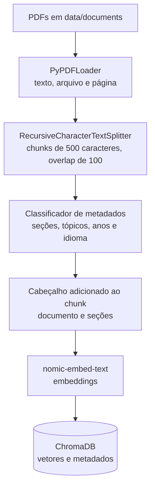
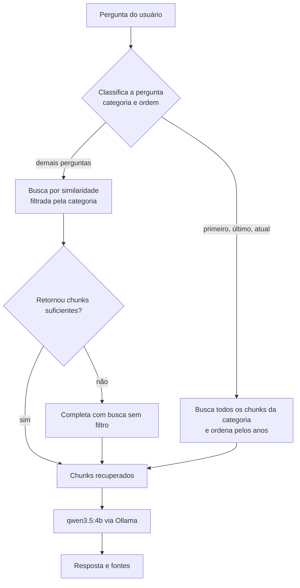

# Local RAG — Sistema de Perguntas e Respostas sobre Documentos PDF

Um sistema de Retrieval-Augmented Generation (RAG) desenvolvido em Python para consultar documentos PDF utilizando inteligência artificial local.

A aplicação permite fazer perguntas em linguagem natural sobre documentos pessoais e profissionais, recuperando trechos relevantes e utilizando um modelo de linguagem para elaborar respostas contextualizadas. Hoje o projeto é usado para consultar os meus currículos (em português) e a minha carta de apresentação (em inglês).

O projeto utiliza Ollama para executar os modelos localmente, ChromaDB para armazenamento e recuperação vetorial e LangChain para integrar as diferentes etapas do processamento. Cada trecho dos documentos recebe metadados (seção, tópicos, anos e idioma) gerados por um classificador baseado em regras, usados para filtrar e ordenar a busca.

O principal objetivo é explorar, na prática, como construir uma aplicação baseada em RAG, entendendo não apenas como conectar um modelo de linguagem a documentos, mas também como funciona o processo de extração, fragmentação, classificação, indexação e recuperação de informações.

## Objetivos do projeto

- Construir um pipeline completo de RAG utilizando ferramentas open source.
- Processar documentos PDF e transformar seu conteúdo em unidades menores de informação (chunks).
- Classificar os chunks com metadados, sem depender de API externa nem de um LLM para isso.
- Gerar embeddings para representar semanticamente os textos.
- Armazenar e consultar vetores utilizando um banco de dados vetorial.
- Recuperar informações relevantes a partir de perguntas em linguagem natural, usando os metadados para filtrar e ordenar.
- Integrar um LLM local para gerar respostas baseadas no contexto recuperado.
- Preservar a rastreabilidade das informações, identificando os documentos e páginas utilizados como fontes.

## Tecnologias utilizadas

| Tecnologia | Responsabilidade |
|---|---|
| Python 3.12 | Linguagem principal |
| LangChain | Orquestração do pipeline RAG |
| Ollama | Execução local dos modelos de IA |
| Qwen 3.5 4B | Modelo de linguagem para geração de respostas |
| Nomic Embed Text | Modelo utilizado para geração de embeddings |
| ChromaDB | Armazenamento e busca vetorial |
| PyPDFLoader | Extração de conteúdo dos documentos PDF |
| RecursiveCharacterTextSplitter | Fragmentação dos documentos |
| Classificador por regras (`re`, `unicodedata`) | Geração dos metadados dos chunks |

## Arquitetura do sistema

O sistema tem dois fluxos: a indexação, executada quando o banco vetorial está vazio, e a consulta, executada a cada pergunta.

### Indexação



### Consulta



## Como funciona

### 1. Carregamento dos documentos

Os arquivos PDF ficam em `data/documents/`. O carregador percorre os documentos e extrai o conteúdo com o `PyPDFLoader`, mantendo metadados como origem do arquivo e número da página.

### 2. Fragmentação do conteúdo (Chunking)

Os documentos são divididos em chunks com o `RecursiveCharacterTextSplitter`:

- Chunk size: 500 caracteres.
- Chunk overlap: 100 caracteres.

O overlap permite que chunks consecutivos compartilhem parte do conteúdo, reduzindo a perda de contexto nas regiões em que ocorre a divisão.

### 3. Classificação e metadados

Cada chunk é analisado pelo `metadata_classifier.py`, que gera os metadados descritos na seção abaixo e adiciona ao início do texto um cabeçalho como `[Documento: Currículo | Seção: Experiência profissional]`. O cabeçalho entra no embedding e ajuda a busca a diferenciar, por exemplo, um cargo de uma formação.

### 4. Geração de embeddings

Cada chunk é convertido em um vetor com o modelo `nomic-embed-text`, o que permite encontrar conteúdos relacionados à pergunta mesmo quando as palavras não são as mesmas do documento.

### 5. Armazenamento vetorial

Os vetores são armazenados no ChromaDB junto com o conteúdo e os metadados. O banco é persistente: os chunks só são inseridos quando ele está vazio. Ao alterar os documentos ou as regras do classificador, apague a pasta do banco para reconstruí-lo.

### 6. Recuperação de informações (Retrieval)

A pergunta passa pelo mesmo classificador de categorias e a busca segue um de dois caminhos:

- **Perguntas cronológicas** (primeiro, último, atual, mais recente): a similaridade semântica não indica qual trecho é o mais antigo ou o mais recente. O retriever busca todos os chunks da categoria, remove repetidos e ordena pelos anos citados em cada um.
- **Demais perguntas:** busca por similaridade filtrada pelas categorias prováveis da pergunta. Se o filtro retornar menos chunks que o necessário, o resultado é completado com uma busca sem filtro, para que um erro de classificação não esconda a resposta.

### 7. Geração da resposta (Generation)

Os chunks recuperados são enviados ao `qwen3.5:4b`, executado localmente pelo Ollama. Além da resposta, a aplicação retorna os documentos utilizados como fontes, com nome do arquivo, página e seção.

## Classificador de metadados

O `metadata_classifier.py` é específico para currículos e cartas de apresentação, que são os documentos que uso no projeto. As regras refletem esse tipo de documento: nomes de seções em português e inglês, formato de datas dos currículos, verbos que iniciam os bullets de experiência, e os nomes das minhas empresas e projetos, que ficam em listas editáveis no início do arquivo. Para usar o sistema com outro tipo de documento, as regras precisam ser reescritas.

A classificação não usa LLM. Ela funciona por pontuação:

- **Cabeçalhos de seção** (Experiência, Formação acadêmica, Competências, Idiomas, Contato) têm o maior peso.
- **Padrões estruturais** vêm em seguida: intervalos de datas como `10/2020 - 04/2022`, bullets que começam com verbos de ação, e-mail, telefone, URLs e linhas como `Inglês: Intermediário` ou `Tech Stack:`.
- **Palavras-chave** isoladas têm o menor peso.

Como os chunks têm 500 caracteres, um mesmo chunk costuma misturar seções. Por isso ele recebe uma categoria principal e também uma flag para cada categoria detectada. Chunks sem sinais suficientes herdam a categoria do chunk anterior do mesmo documento.

Também há uma etapa de limpeza do texto antes da classificação, que remove ruídos da extração dos PDFs: ligaduras (`fi`, `ffl`), ícones convertidos em caracteres cirílicos e rodapés como `Page 1 of 3`.

### Metadados gerados

| Metadado | Conteúdo |
|---|---|
| `category` | Categoria principal do chunk |
| `sections` | Todas as categorias detectadas no chunk |
| `has_<categoria>` | Flag booleana por categoria, usada nos filtros do ChromaDB |
| `topics` | Tecnologias e assuntos citados (Node.js, SQL Server, suporte técnico, etc.) |
| `first_year` e `last_year` | Menor e maior ano citados, usados na ordenação cronológica |
| `doc_type` | `resume` ou `cover_letter`, pelo nome do arquivo |
| `language` | `pt` ou `en` |

### Categorias

| Categoria | Conteúdo |
|---|---|
| `professional_profile` | Resumo, objetivo e apresentação |
| `professional_experience` | Cargos, empresas, períodos e atividades |
| `education` | Formação acadêmica, cursos e certificações |
| `technical_skills` | Linguagens, frameworks, bancos de dados e ferramentas |
| `languages` | Idiomas e níveis |
| `contact_information` | E-mail, telefone e links |
| `projects` | Projetos pessoais e acadêmicos |

## Estrutura do projeto

```text
rag/
│
├── data/
│   ├── documents/
│   │   ├── arquivo1.pdf
│   │   └── arquivo2.pdf
│   └── chroma.sqlite3
│
├── src/
│   ├── helper/
│   │   └── print_section.py
│   ├── config.py
│   ├── document_loader.py
│   ├── embeddings.py
│   ├── metadata_classifier.py
│   ├── qa_chain.py
│   └── vector_store.py
│
├── .venv/
├── main.py
├── requirements.txt
├── .gitignore
└── README.md
```

### Responsabilidade dos módulos

| Arquivo | Responsabilidade |
|---|---|
| `config.py` | Centraliza configurações e parâmetros utilizados pela aplicação. |
| `document_loader.py` | Localiza os arquivos PDF e realiza a extração do conteúdo. |
| `embeddings.py` | Configura o modelo de embeddings e realiza a fragmentação dos documentos. |
| `metadata_classifier.py` | Classifica os chunks, gera os metadados e implementa o filtro e a ordenação usados na busca. |
| `vector_store.py` | Gerencia o ChromaDB, o enriquecimento dos chunks e o retriever. |
| `qa_chain.py` | Configura o modelo de linguagem e constrói a cadeia de perguntas e respostas. |
| `helper/print_section.py` | Funções de saída do terminal (títulos, informações e avisos). |
| `main.py` | Ponto de entrada, responsável por orquestrar o fluxo principal. |

## Requisitos

- Python 3.12 ou superior.
- Ollama instalado.
- Git (opcional, para clonar o repositório).
- Modelos necessários disponíveis no Ollama.

## Configuração do ambiente

### 1. Clonar o repositório

```bash
git clone https://github.com/SEU-USUARIO/SEU-REPOSITORIO.git

cd rag
```

### 2. Criar o ambiente virtual

```bash
python -m venv .venv
```

Ativar no Windows PowerShell:

```powershell
.venv\Scripts\Activate.ps1
```

### 3. Instalar as dependências

```bash
pip install -r requirements.txt
```

### 4. Baixar os modelos no Ollama

Modelo de linguagem:

```bash
ollama pull qwen3.5:4b
```

Modelo de embeddings:

```bash
ollama pull nomic-embed-text
```

Certifique-se de que o Ollama esteja em execução antes de iniciar a aplicação.

### 5. Adicionar os documentos

Coloque os PDFs em `data/documents/`. Para que o classificador identifique a carta de apresentação, o nome do arquivo deve conter `cover` ou `carta`. Os demais arquivos são tratados como currículo.

### 6. Executar o projeto

```bash
python main.py
```

Os documentos são processados e a base vetorial é criada na primeira execução. Nas seguintes, o banco existente é reutilizado.

## Exemplo de utilização

Uma pergunta possível:

```text
Qual foi o primeiro emprego de Gabriel Sampaio?
```

O sistema:

1. Identifica que a pergunta é sobre experiência profissional e que pede o item mais antigo.
2. Busca todos os chunks de experiência profissional.
3. Ordena os chunks pelo menor ano citado em cada um.
4. Encaminha os primeiros ao modelo de linguagem.
5. Gera a resposta com base nesses trechos.

Exemplo de resposta esperada:

```text
A primeira experiência profissional registrada foi
como estagiário na GLP Laboratórios, a partir de
outubro de 2019.
```

A aplicação também apresenta as fontes utilizadas na resposta, com nome do arquivo, página e seção.

## Decisões técnicas e aprendizados

**Fragmentação e preservação de contexto**

O tamanho dos chunks influencia diretamente a recuperação. Chunks de 500 caracteres separam cabeçalhos do conteúdo e misturam seções, o que dificulta a classificação.

**Qualidade da recuperação**

Um LLM não consegue responder corretamente com informações que não foram recuperadas. Avaliar o Retriever é tão importante quanto avaliar a resposta final.

**Metadados em vez de LLM para classificar**

Classificar os chunks com um LLM exigiria mais recursos de hardware ou uma API paga. Um classificador por regras roda em milissegundos, localmente, e seus erros podem ser inspecionados e corrigidos diretamente nas regras.

**Perguntas cronológicas**

Perguntas como "primeiro" ou "atual" dependem da ordem das datas, não do significado do texto. Guardar os anos de cada chunk como metadado permite ordenar os resultados antes de enviá-los ao modelo.

**Chunks com mais de uma seção**

Como um chunk pode conter, por exemplo, o fim de uma experiência e o início da formação, os metadados guardam todas as seções detectadas. Isso evita que o filtro exclua chunks relevantes por causa da categoria principal.

**Limpeza do texto extraído**

PDFs gerados por ferramentas diferentes produzem ruídos distintos (ligaduras, ícones, rodapés). Limpar o texto antes da classificação melhora a detecção das regras.

**Rastreabilidade**

Retornar as fontes permite verificar se a resposta está fundamentada nos documentos originais.

**Execução local**

O Ollama executa a geração de respostas e a criação de embeddings localmente, sem dependência de serviços externos e APIs pagas.

## Possíveis melhorias

- Implementar chunking por seção, para não separar cargos dos seus bullets.
- Comparar diferentes tamanhos de chunks e valores de overlap.
- Avaliar a qualidade da recuperação utilizando métricas como Precision@K e Recall@K.
- Comparar busca vetorial tradicional com estratégias híbridas (BM25 + busca semântica).
- Implementar reranking para melhorar a relevância dos documentos recuperados.
- Mover as regras do classificador (empresas, projetos, cabeçalhos) para um arquivo de configuração.
- Implementar mecanismos para atualização incremental da base vetorial.
- Desenvolver testes automatizados para o classificador, o processamento e a recuperação.

## Considerações finais

Este projeto surgiu como uma forma de estudar e aplicar conceitos de inteligência artificial generativa além da simples utilização de APIs de modelos de linguagem.

A proposta é entender como as informações são extraídas, representadas, classificadas, armazenadas e recuperadas antes de chegar ao modelo responsável pela geração da resposta. Mais do que produzir respostas, o objetivo é construir um sistema em que seja possível investigar o caminho percorrido pela informação, identificar limitações e melhorar progressivamente a qualidade dos resultados.

---

**Desenvolvido por Gabriel Sampaio**

[GitHub](https://github.com/GabrielSampaioS) · [LinkedIn](https://www.linkedin.com/in/gabriel-sampaio0122/)